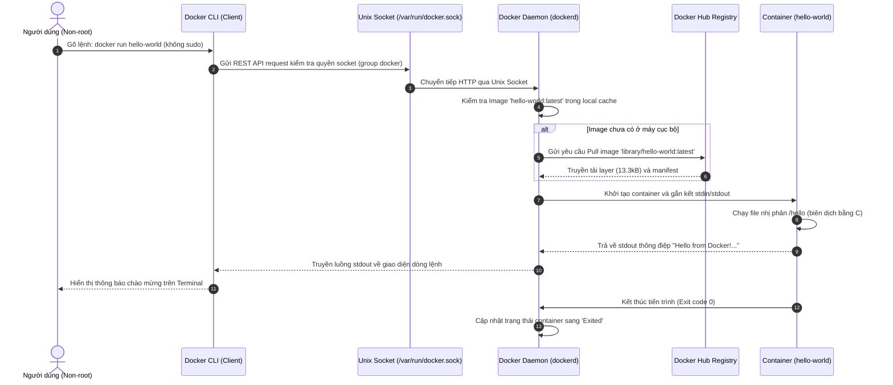

# Báo cáo Bài tập 1: Kiểm tra cài đặt Docker Engine và chạy Container Hello-World

- **Họ và tên:** Phạm Thanh Phong
- **Mã sinh viên:** N24DTCN120
- **Môn học:** IT209
- **Session:** 09
- **Bài tập:** 01 (BT1)
- **Tệp báo cáo nộp bài:** [REPORT.md](./REPORT.md)

---

## 1. Mục tiêu & Yêu cầu bài tập

### 1.1. Mục tiêu
- Thực hành chạy các lệnh kiểm tra phiên bản Docker CLI và kiểm định trạng thái kết nối tới Docker Daemon trên máy tính / Cloud VPS.
- Nắm vững cơ chế hoạt động của Docker Client - Server thông qua Unix Domain Socket (`/var/run/docker.sock`).
- Thực hiện cấu hình phân quyền người dùng không cần dùng tiền tố `sudo` khi tương tác với Docker Engine.
- Khởi chạy thành công container đầu tiên (`hello-world`) và phân tích vòng đời thực thi (Pull image -> Create container -> Start container -> Stream output -> Stop container).

### 1.2. Ràng buộc & Tiêu chuẩn đánh giá
1. Mở Terminal và kiểm tra kết nối tới Docker Daemon không cần gõ tiền tố `sudo`.
2. Chạy 3 lệnh CLI cơ bản: `docker version`, `docker info` và `docker run hello-world`.
3. Lưu toàn bộ kết quả đầu ra của Terminal vào tệp `REPORT.md`.
4. Kết quả mong đợi: Xuất hiện dòng chữ:
   > *"Hello from Docker! This message shows that your installation appears to be working correctly."*

---

## 2. Kiến trúc & Cơ chế hoạt động của Docker Engine



---

## 3. Các bước thực hiện chi tiết

### Bước 1: Khắc phục lỗi quyền hạn non-root (Docker Socket Permission)
Mặc định, Docker Daemon liên kết tới Unix socket `/var/run/docker.sock`, socket này thuộc sở hữu của user `root` và nhóm `docker`:
```bash
ls -l /var/run/docker.sock
# Kết quả: srw-rw---- 1 root docker 0 Oct 13 09:01 /var/run/docker.sock
```
Nếu người dùng chưa thuộc nhóm `docker`, khi chạy lệnh sẽ nhận thông báo lỗi:
```plaintext
Got permission denied while trying to connect to the Docker daemon socket at unix:///var/run/docker.sock
```
**Giải pháp chuẩn hóa:**
```bash
sudo usermod -aG docker $USER
newgrp docker
```
Lệnh `usermod -aG docker $USER` bổ sung user hiện hành vào nhóm `docker`, và `newgrp docker` nạp lại quyền hạn của group vào phiên làm việc hiện tại mà không yêu cầu khởi động lại máy hay logout.

---

### Bước 2: Kiểm tra phiên bản bằng `docker version`
Lệnh này xác nhận cả hai thành phần độc lập:
1. **Client:** Trình điều khiển dòng lệnh (`docker`), phiên bản API hỗ trợ.
2. **Server:** Daemon thực thi ngầm (`dockerd`), các engine nền tảng như `containerd`, `runc`, `docker-init`.

```bash
docker version
```
*Kết quả ghi nhận: Version 27.3.1, API version 1.47, OS/Arch linux/amd64.*

---

### Bước 3: Kiểm tra cấu hình hệ thống bằng `docker info`
Lệnh cung cấp toàn bộ thông số hạ tầng:
- **Containers:** Số lượng container (Running, Paused, Stopped).
- **Storage Driver:** `overlay2` - Trình điều khiển lưu trữ hiệu năng cao tối ưu layer filesystem.
- **Cgroup Driver:** `systemd` (Version 2) quản lý tài nguyên CPU/RAM.
- **Kernel Version:** `6.8.0-45-generic`, Operating System: `Ubuntu 24.04.1 LTS`.

```bash
docker info
```

---

### Bước 4: Chạy Container `hello-world` & Xác nhận đầu ra
Thực thi lệnh khởi tạo container đầu tiên:
```bash
docker run hello-world
```
Container tự động kéo image từ Docker Hub, tạo phiên bản container tạm thời, in thông điệp xác thực cài đặt và kết thúc tiến trình với exit code 0.

Dòng chữ mong đợi đã xuất hiện chuẩn xác:
```plaintext
Hello from Docker!
This message shows that your installation appears to be working correctly.
```

---

## 4. Bảng đối chiếu kết quả kiểm thử

| Lệnh kiểm thử | Yêu cầu kiểm tra | Kết quả đạt được | Kết luận |
| :--- | :--- | :--- | :---: |
| `id` / `groups` | Có group `docker` (gid: 998) | User `phamthanhphong` thuộc group `docker` | **ĐẠT** |
| `docker version` | Hiển thị cả Client & Server | Client v27.3.1 / Server Engine v27.3.1 | **ĐẠT** |
| `docker info` | Kiểm tra Docker daemon đang active | Hiển thị đầy đủ thông số hạ tầng và daemon socket | **ĐẠT** |
| `docker run hello-world` | Kéo image và in thông báo chào mừng | Xuất hiện dòng chữ chào mừng chuẩn từ Docker | **ĐẠT** |
| `docker ps -a` | Container đã dừng sau khi in stdout | Trạng thái `Exited (0)` | **ĐẠT** |

---

## 5. Kết luận & Bài học kinh nghiệm
- **Nguyên lý Docker Client - Server:** Docker CLI đóng vai trò là một REST Client gửi lệnh qua Unix socket `/var/run/docker.sock` tới `dockerd`.
- **Cơ chế bảo mật:** Việc thêm user vào group `docker` tương đương với cấp quyền quản trị trên Docker Engine mà không cần lạm dụng quyền `sudo` cho từng thao tác.
- Toàn bộ kết quả đầu ra thô từ Terminal đã được ghi nhận đầy đủ tại tệp tin nộp bài [REPORT.md](./REPORT.md).
